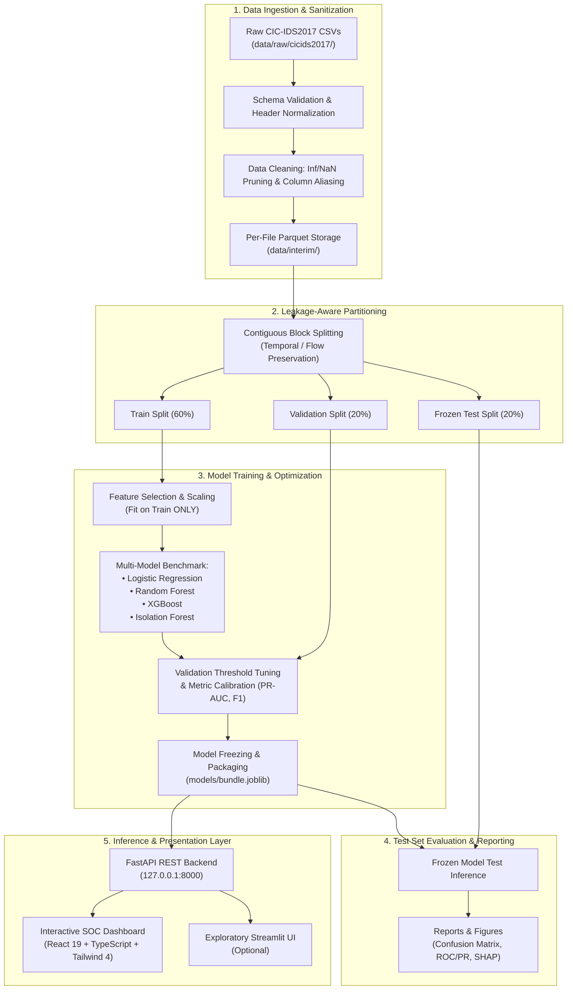

#  Sentinel NIDS: ML-Based Network Intrusion Detection System

<p align="center">
  
  
  
  
  
  
  
</p>

---

##  Executive Summary

**Sentinel NIDS** is an enterprise-oriented, dataset-driven Network Intrusion Detection System (NIDS) designed for offline, forensic-grade analysis of bidirectional network flow records from the benchmark **CIC-IDS2017** dataset.

The system combines statistical machine learning classifiers (**Logistic Regression**, **Random Forest**, **XGBoost**, and **Isolation Forest**) with strict, leakage-aware experimental methodologies. It provides automated detection of malicious traffic, maps anomalous flows to standardized threat families, exposes inference via a high-performance **FastAPI** backend, and delivers real-time investigative telemetry through an interactive, terminal-themed **SOC (Security Operations Center) React Dashboard**.

> [!IMPORTANT]
> **Academic & Research Integrity Notice**:
> This project follows strict scientific evaluation principles. Train/validation/test splits are constructed to eliminate data leakage. Final benchmark metrics are derived exclusively from frozen models evaluated on the held-out test split. Uncalibrated scores are treated as statistical model outputs rather than verified ground truth.
>
> **Current Status**: Core architecture, React SOC frontend, API specifications, and pipeline scaffolds are established. Model benchmarking artifacts are generated via the reproducible pipeline under `reports/`.

---

## 📑 Table of Contents

- [Executive Summary](#-executive-summary)
- [System Architecture](#-system-architecture)
- [Key Features](#-key-features)
- [Detection Models & Attack Taxonomy](#-detection-models--attack-taxonomy)
- [Security Operations Center (SOC) Frontend](#-security-operations-center-soc-frontend)
- [API Service Specification](#-api-service-specification)
- [Methodology & Leakage Prevention](#-methodology--leakage-prevention)
- [Repository Structure](#-repository-structure)
- [Installation & Setup](#-installation--setup)
- [Pipeline Execution](#-pipeline-execution)
- [Mini-Project Assessment & Rubric Alignment](#-mini-project-assessment--rubric-alignment)
- [Ethical, Privacy & Security Disclaimers](#-ethical-privacy--security-disclaimers)
- [References & Citation](#-references--citation)

---

## 🏗️ System Architecture

The end-to-end data pipeline guarantees strict data isolation, reproducible model persistence, and seamless SOC analyst interaction (detailed in [`docs/ARCHITECTURE.md`](file:///c:/Users/ishaan/OneDrive/Desktop/ML%20PROJECT/docs/ARCHITECTURE.md)):



---

## ✨ Key Features

- **🛡️ Leakage-Aware Cross-Validation**: Preprocessing (imputation, scaling, encoding) is strictly fit on training data alone. Splits are partitioned across continuous temporal blocks to avoid flow-leakage across windows.
- **⚡ High-Throughput REST API**: Asynchronous endpoints engineered with **FastAPI** and **Pydantic v2** supporting single-record inspection (`/predict`), high-volume batch scoring (`/predict/batch`), and model health monitoring (`/health`).
- **🖥️ Phosphor-Green SOC Analyst Terminal**: A sleek, cyber-themed **React 19 + TypeScript** interface incorporating dark-mode aesthetics, custom bento grids, Recharts data visualizers, and Lucide telemetry icons.
- **🔍 Explainable AI (XAI)**: Integrated **SHAP (SHapley Additive exPlanations)** attribution for flow-level decision explainability, revealing which packet headers or flow durations triggered an alert.
- **📊 Multi-Class Threat Triage**: Goes beyond naive binary detection by classifying suspicious flows into structured threat families (DoS/DDoS, Port Scans, Brute Force, Web Infiltration, Botnets).
- **🔒 Privacy-Preserving Offline Operation**: Operates purely on local flow datasets. Zero packet interception, zero external telemetry calls, and strict local artifact isolation under `data/runs/`.

---

## 🎯 Detection Models & Attack Taxonomy

### Evaluated Model Architectures

| Model Class | Algorithm | Target Objective | Key Hyperparameters & Characteristics |
|---|---|---|---|
| **Linear Baseline** | Logistic Regression | Linear decision boundary baseline | L2 penalty (`C=1.0`), scaled standard features |
| **Ensemble (Bagging)** | Random Forest | Non-linear feature interactions & robustness | `n_estimators=150`, `max_depth=20`, balanced subsampling |
| **Ensemble (Boosting)** | XGBoost | SOTA gradient boosting on tabular network flows | `max_depth=6`, `learning_rate=0.08`, tree subsampling |
| **Unsupervised Anomaly** | Isolation Forest | Zero-day & distribution outlier detection | `contamination=0.15`, path length anomaly score |

### Target Attack Taxonomy (CIC-IDS2017)

The system maps 14 specific attack subtypes into 5 primary operational threat families (configured in [`config/label_map.yaml`](file:///c:/Users/ishaan/OneDrive/Desktop/ML%20PROJECT/config/label_map.yaml)):

```
├── BENIGN (Normal Network Behavior)
└── MALICIOUS
    ├── DoS / DDoS (DDoS, DoS Hulk, GoldenEye, Slowloris, Slowhttptest, Heartbleed)
    ├── PortScan (Inbound Reconnaissance & Probe Traffic)
    ├── Brute Force (FTP-Patator, SSH-Patator)
    ├── Web Attacks (SQL Injection, Cross-Site Scripting [XSS], Web Brute Force)
    └── Botnet & Infiltration (Botnet ARES, Internal Privilege Escalation)
```

---

## 💻 Security Operations Center (SOC) Frontend

The user interface is an enterprise-grade cyber command center built with **React 19**, **Vite**, **TypeScript**, and **Tailwind CSS v4**, located in [`frontend/`](file:///c:/Users/ishaan/OneDrive/Desktop/ML%20PROJECT/frontend).

### Dedicated Operations Views

1. **Security Overview (`overview`)**: High-level SOC telemetry featuring key stat metrics (total flows, predicted malicious, predicted benign, operating threshold), traffic volume timeline, threat distribution donut charts, and diagnostic pipeline monitors.
2. **Threat Alerts (`alerts`)**: Triage panel displaying model-flagged flows with confidence scores, assigned severity (Low, Medium, High, Critical), protocol metadata, and one-click sanitized CSV exports.
3. **Traffic Investigation (`investigation`)**: Deep-dive forensics terminal showing individual flow packet metrics, bidirectional payload statistics, inter-arrival time (IAT), and local feature importance explanations.
4. **Network Activity (`network`)**: Protocol breakdowns (TCP/UDP/ICMP), communication port heatmaps, timeline aggregates, and talker endpoint distributions.
5. **Model Performance (`performance`)**: Visual benchmark dashboard displaying ROC curves, Precision-Recall curves, confusion matrices, and cross-model comparison tables.
6. **Traffic Analysis Lab (`lab`)**: Secure local file drop-zone supporting up to 200 MB CSV uploads for offline batch analysis and scoring.

---

## 🔌 API Service Specification

The FastAPI microservice ([`backend/`](file:///c:/Users/ishaan/OneDrive/Desktop/ML%20PROJECT/backend)) exposes low-latency endpoints for automated inference and integration:

| Method | Endpoint | Description |
|---|---|---|
| `GET` | `/health` | Healthcheck returning model readiness, schema version, and uptime |
| `GET` | `/model/info` | Metadata on active model architecture, features, training date, and hash |
| `POST` | `/predict` | Single flow inference with predicted label, confidence, and severity |
| `POST` | `/predict/batch` | High-throughput batch inference accepting a list or CSV payload |
| `POST` | `/explain` | Feature attribution endpoint returning top contributing SHAP values |

### Example Inference Request

```bash
curl -X POST "http://127.0.0.1:8000/predict" \
  -H "Content-Type: application/json" \
  -d '{
    "Destination_Port": 80,
    "Flow_Duration": 112740,
    "Total_Fwd_Packets": 3,
    "Total_Backward_Packets": 4,
    "Total_Length_of_Fwd_Packets": 161,
    "Total_Length_of_Bwd_Packets": 488,
    "Fwd_Packet_Length_Max": 161,
    "Flow_IAT_Mean": 18790.0,
    "FIN_Flag_Count": 0,
    "SYN_Flag_Count": 1
  }'
```

---

## 🔬 Methodology & Leakage Prevention

Data leakage is the most pervasive flaw in published NIDS literature. This project enforces structural engineering safeguards (documented in [`docs/DECISIONS.md`](file:///c:/Users/ishaan/OneDrive/Desktop/ML%20PROJECT/docs/DECISIONS.md)):

1. **Contiguous & Temporal Splitting**:
   - Random record shuffling across bidirectional flows introduces temporal cross-talk and memorization. Splits are partitioned into contiguous blocks to mirror real-world forensic deployment.
2. **Isolation of Preprocessing Transformers**:
   - Imputers, scalers (`StandardScaler`), and frequency encoders are calculated strictly on the **Training set** and subsequently applied to Validation and Test splits without refitting.
3. **Model Freezing Before Final Evaluation**:
   - Hyperparameter exploration and operating threshold decisions (e.g., balancing Precision vs. Recall to minimize False Alarm Rates) are executed exclusively on the **Validation set**.
   - Once chosen, the model weights and thresholds are frozen. Test evaluation is executed exactly once to populate `reports/test_metrics.json`.

---

## 📂 Repository Structure

```text
ML-Based-NIDS/
├── .github/workflows/               # Continuous integration workflows
│   └── ci.yml                       # Python lint/test and React frontend verification
├── config/                          # Central configuration and hyperparameters
│   ├── config.yaml                  # Pipeline parameters, paths, model configs
│   └── label_map.yaml               # Attack family and severity mappings
├── data/                            # Data directory (Git-ignored)
│   ├── raw/cicids2017/              # Raw CIC-IDS2017 source CSVs
│   ├── interim/                     # Cleaned, per-file Parquet partitions
│   ├── processed/                   # Leakage-aware train/val/test splits
│   └── runs/                        # Local analyst run logs & session records
├── models/                          # Serialized model bundles & freeze checksums
├── reports/                         # Generated benchmark reports, metrics & figures
│   └── figures/                     # ROC curves, PR curves, and confusion matrices
├── notebooks/                       # Exploratory analysis and prototyping notebooks
├── src/nids/                        # Core Python NIDS package
│   ├── common/                      # Shared config, logging, paths, and custom exceptions
│   ├── data/                        # CSV inspection, cleaning, sanitation & splitting
│   ├── features/                    # Feature selection, scaling & transformers
│   ├── training/                    # Model training, hyperparameter tuning & calibration
│   ├── evaluation/                  # Classification metrics, ROC/PR, and figures
│   ├── inference/                   # Inference bundles, prediction pipeline & severity rules
│   └── storage/                     # Local run storage & optional database adapters
├── backend/                         # FastAPI application
│   ├── routes/                      # API endpoint routers (/predict, /explain, /health)
│   ├── schemas/                     # Pydantic v2 validation schemas
│   └── main.py                      # FastAPI application entrypoint
├── frontend/                        # Modern React SOC Terminal Dashboard
│   ├── src/                         # Application source (App.tsx, components, hooks)
│   │   ├── components/ui/           # Reusable UI primitives (bento grid, buttons, empty states)
│   │   └── lib/                     # Dashboard metadata, navigation, and API clients
│   ├── package.json                 # Node dependencies (React 19, Tailwind 4, Lucide, Recharts)
│   └── vite.config.ts               # Vite configuration
├── scripts/                         # Pipeline orchestration & deployment utilities
│   └── run_pipeline.py              # CLI tool for validation, cleaning, training & eval
├── tests/                           # Comprehensive test suite
│   ├── unit/                        # Data cleaning, feature transformation & metric tests
│   ├── api/                         # FastAPI route and payload validation tests
│   └── integration/                 # End-to-end pipeline verification
├── docs/                            # Academic & technical documentation
│   ├── ARCHITECTURE.md              # System architecture details
│   ├── ASSESSMENT.md                # 15-mark university rubric alignment & tracking
│   ├── DATASET.md                   # CIC-IDS2017 dataset terms, provenance & citation
│   ├── DECISIONS.md                 # Architecture Decision Records (ADRs)
│   └── PROGRESS.md                  # Implementation milestones and acceptance log
├── requirements.txt                 # Core Python production dependencies
├── requirements-dev.txt             # Testing and linting tooling (pytest, ruff, black)
└── pyproject.toml                   # Standard Python project packaging specification
```

---

## 🚀 Installation & Setup

### Prerequisites

- **Python**: 3.10, 3.11, or 3.12 (Python 3.11 recommended)
- **Node.js**: v20.19+ or v22.12+ (for the React Frontend)
- **RAM**: Minimum 8 GB (16 GB recommended for full dataset training)
- **Disk Space**: ~10 GB free space recommended for Parquet caching

---

### 1. Python Environment Setup

#### Windows (PowerShell)
```powershell
# Create and activate virtual environment
py -3.11 -m venv .venv
.venv\Scripts\Activate.ps1

# Upgrade pip and install dependencies
python -m pip install --upgrade pip
pip install -r requirements.txt
pip install -r requirements-dev.txt
pip install -e .
```

#### Linux / macOS
```bash
# Create and activate virtual environment
python3 -m venv .venv
source .venv/bin/activate

# Upgrade pip and install dependencies
python -m pip install --upgrade pip
pip install -r requirements.txt
pip install -r requirements-dev.txt
pip install -e .
```

---

### 2. Frontend Setup (React SOC Dashboard)

```bash
cd frontend
npm install
npm run dev
```
The dashboard will be accessible at `http://localhost:5173`.

---

### 3. Dataset Acquisition

1. Download the official **CIC-IDS2017** CSV archive from the [Canadian Institute for Cybersecurity (UNB)](https://www.unb.ca/cic/datasets/ids-2017.html).
2. Extract the CSV files directly into the raw data directory:
   ```text
   data/raw/cicids2017/
   ├── Friday-WorkingHours-Afternoon-DDos.pcap_ISCX.csv
   ├── Friday-WorkingHours-Afternoon-PortScan.pcap_ISCX.csv
   ├── Friday-WorkingHours-Morning.pcap_ISCX.csv
   └── ...
   ```
*(Note: Raw dataset files are ignored by git to protect repository size and license terms).*

---

## ⚙️ Pipeline Execution

Run the complete pipeline or individual stages via the CLI runner:

```bash
# Stage 1: Validate dataset files, schema integrity, and column mappings
python scripts/run_pipeline.py --stage validate

# Stage 2: Clean data and generate leakage-aware train/val/test splits
python scripts/run_pipeline.py --stage process

# Fast Mode: Subsample dataset for rapid prototyping and validation
python scripts/run_pipeline.py --fast

# Full Pipeline: Clean, train models, tune thresholds, and evaluate test set
python scripts/run_pipeline.py --full

# Start the local FastAPI inference service
uvicorn backend.main:app --host 127.0.0.1 --port 8000 --reload
```

---

## 🎓 Mini-Project Assessment & Rubric Alignment

This repository is structured around the **15-Mark Mini-Project Rubric** and the **10-Page Research Report**:

| Area | Marks | Implementation & Repository Evidence |
|---|:---:|---|
| **Data Cleaning & Splitting** | **3** | Documented cleaning logic, handling of `Inf`/`NaN` flow values, feature aliasing, and contiguous temporal block splitting in `src/nids/data/`. |
| **Model Comparison & Analytics** | **4** | Comparative benchmarking of 4 distinct architectures (Logistic Regression, Random Forest, XGBoost, Isolation Forest) with ROC/PR curves, F1-scores, and honest evaluation in `reports/`. |
| **UI Deployment & Accessibility** | **4** | Enterprise React 19 SOC terminal dashboard (`frontend/`), cross-platform responsive layout, offline file upload lab, and optional Streamlit explorer. |
| **Code Quality & Documentation** | **4** | Clean modular architecture, Ruff/Black code standards, unit & API test suites (`tests/`), complete architecture records, and academic report alignment. |

> Detailed progress tracking, milestones, and report templates are maintained in [`docs/ASSESSMENT.md`](file:///c:/Users/ishaan/OneDrive/Desktop/ML%20PROJECT/docs/ASSESSMENT.md).

---

## ⚖️ Ethical, Privacy & Security Disclaimers

1. **Offline Scope Only**: This software is built for forensic and retrospective network-flow analysis. It does **not** capture raw network interfaces, promiscuously listen to sockets, sniff live packets, or monitor third-party communications.
2. **Privacy by Design**: All analyses execute locally on the analyst's machine. Flow records and IP addresses are not transmitted to external telemetry services or cloud vendors.
3. **Statistical Outputs**: Predictions represent probabilistic model inferences derived from 2017 simulated synthetic lab environments. They must serve as triage aids for human security analysts, not autonomous incident triggers.

---

## 📚 References & Citation

If you use this codebase or project scaffold in your research or coursework, please cite the underlying CIC-IDS2017 dataset:

```bibtex
@inproceedings{sharafaldin2018toward,
  title={Toward Generating a New Intrusion Detection Dataset and Intrusion Traffic Characterization},
  author={Sharafaldin, Iman and Lashkari, Arash Habibi and Ghorbani, Ali A.},
  booktitle={Proceedings of the 4th International Conference on Information Systems Security and Privacy (ICISSP)},
  pages={108--116},
  year={2018},
  organization={SCITEPRESS}
}
```

---

<p align="center">
  <sub>Built for advanced machine learning research and modern security operations.</sub>
</p>
