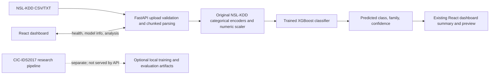

# System Architecture

The React dashboard talks to a local FastAPI adapter. The adapter loads the trained NSL-KDD XGBoost model and keeps file uploads local. It accepts NSL-KDD rows, not CIC-IDS2017 flow CSVs.

## Active inference model

The FastAPI service reads `models/ml_ctd/xgboost_model.pkl` (or `MLCTD_MODEL_PATH`) at startup. The model artifact contains the XGBoost classifier and its fitted label encoders and scaler. It is a trusted local pickle artifact; the API never accepts model files from requests. If the file is missing or cannot be loaded, `/health` returns `degraded` and prediction endpoints return an error instead of fabricating results.

The input follows the NSL-KDD schema: 41 connection features with optional `label` and `difficulty` columns. The prediction endpoint requires all fields used by the saved preprocessing objects. It encodes `protocol_type`, `service`, and `flag`, applies the saved numeric scaler, and returns the predicted attack label and its mapped family (`Normal`, `DoS`, `Probe`, `R2L`, or `U2R`). The score is class confidence; it is not confirmation of an attack.

## React API contract

- `GET /health`: API and NSL-KDD model readiness.
- `GET /model/info`: model ID, features, and supported families.
- `POST /predict` and `/predict/batch`: NSL-KDD connection inference.
- `POST /analyze/csv`: CSV/TXT upload, parsed and scored in chunks of 1,000 rows; returns counts and up to 100 preview rows.

The dashboard exposes API readiness, latest analysis counts, and CSV upload.

## Separate CIC-IDS2017 training pipeline

[`scripts/run_pipeline.py`](../scripts/run_pipeline.py) remains as a separate research workflow. It reads CSVs from `data/raw/cicids2017/`, creates stratified random row partitions (60% train, 20% validation, 20% test), and compares Logistic Regression, Random Forest, Extra Trees, and XGBoost. It writes metrics to `reports/benchmark_metrics.json` and a model bundle under `models/`. That bundle is not loaded by the active FastAPI service.

The random row split may place repeated or temporally adjacent flows in different partitions and make performance look optimistic. Use a temporal or capture-group split before presenting final academic performance.
