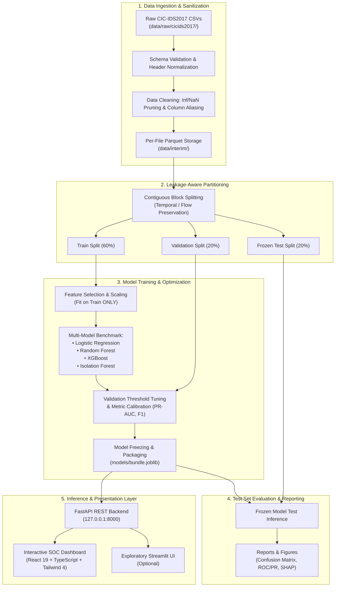

# System Architecture

Sentinel NIDS is engineered as a modular, decoupled forensic network intrusion detection system. The architecture separates raw data ingestion, statistical machine learning pipelines, RESTful inference serving, and cyber analyst telemetry.

## High-Level Architecture Flow

## Architectural Components

### 1. Ingestion & Preprocessing Layer (`src/nids/data/`)
- **Schema Validation**: Validates that raw input CSVs match the CIC-IDS2017 feature specification (78+ statistical flow features).
- **Sanitization**: Strips whitespace, normalizes column aliases, strips or caps infinite values (`+inf`, `-inf`), and drops rows with corrupted headers.
- **Interim Storage**: Persists cleaned datasets as columnar Parquet files (`data/interim/`) with Snappy compression for 10x faster I/O.

### 2. Leakage-Aware Partitioning Layer (`src/nids/features/`)
- **Block-Based Splitting**: Avoids random row-wise shuffling which introduces temporal leakage across bidirectional conversations.
- **Transformer Fit Isolation**: Scalers (`StandardScaler`), missing value imputers, and one-hot encoders are strictly fitted on the Training split only.

### 3. Model Training & Validation Layer (`src/nids/training/`)
- **Cross-Model Benchmarking**: Trains Logistic Regression (baseline), Random Forest, XGBoost (SOTA boosted trees), and Isolation Forest (unsupervised anomaly).
- **Threshold Tuning**: Selects the operational decision boundary on the Validation set to minimize the False Alarm Rate (FAR) while maximizing Recall.
- **Model Freezing**: Generates SHA-256 checksums and locks model weights into `models/bundle.joblib`.

### 4. Evaluation & Reporting Layer (`src/nids/evaluation/`)
- Evaluates the frozen model against the untouched Test partition.
- Outputs structured metrics (`reports/test_metrics.json`) and visualization figures (`reports/figures/roc_curve.png`, `pr_curve.png`, `confusion_matrix.png`).

### 5. Serving & Telemetry Layer (`backend/` & `frontend/`)
- **FastAPI Backend**: Asynchronous microservice providing `/health`, `/predict`, `/predict/batch`, and `/explain`.
- **React SOC Frontend**: Cyber-themed command console with bento grid cards, live pipeline monitors, and forensic analysis lab.
