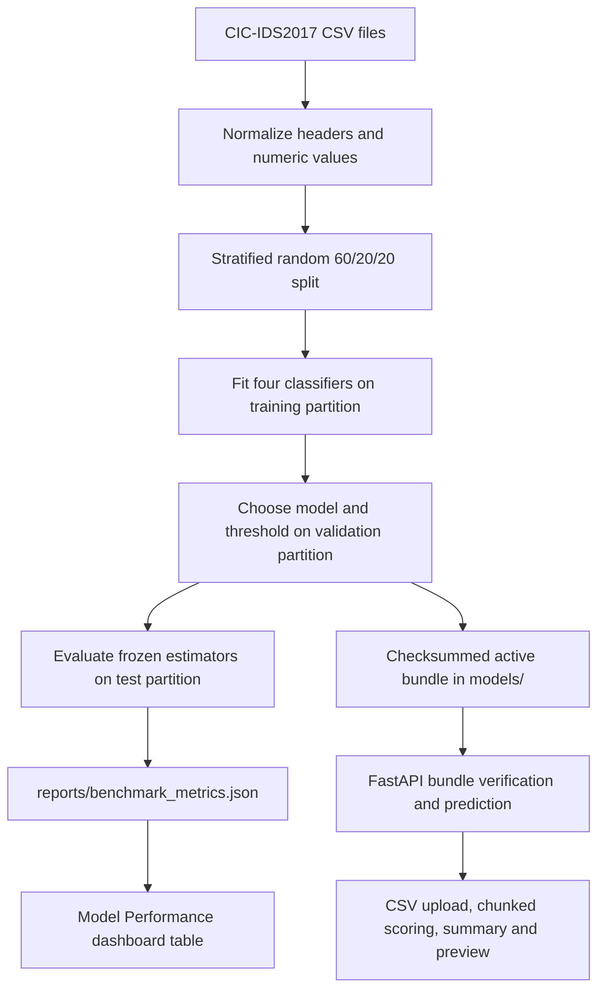

# System Architecture

Sentinel NIDS currently supports offline binary classification of CIC-IDS2017 flow CSVs. Training and inference run locally; uploaded CSV data is not saved by the API.

## Training

[`scripts/run_pipeline.py`](../scripts/run_pipeline.py) reads all CSV files in `data/raw/cicids2017/`, strips column-name whitespace, drops identifier columns and the source label from features, converts remaining feature values to numeric, and treats invalid and infinite values as missing. The task label is binary: `BENIGN` versus all attack labels.

The script creates stratified random row partitions (60% train, 20% validation, 20% test), and fits median imputers and any scaler inside each model pipeline using training data. It benchmarks Logistic Regression, Random Forest, Extra Trees, and XGBoost. Validation PR-AUC selects the active model; the operating threshold is selected by validation F1. Test metrics and confusion matrices for every candidate are written to `reports/benchmark_metrics.json`.

**Evaluation limitation:** the random row split may place repeated or temporally adjacent flows in different partitions. The resulting metrics can be optimistic. Use a temporal or capture-group split before reporting final academic performance.

The selected estimator, ordered feature names, threshold, library versions, dataset metadata, and feature ranges are written under `models/<model-id>/`. `models/ACTIVE` selects the bundle. Its SHA-256 checksum is verified before the API unpickles it.

## API and Dashboard

- `GET /health`: service and model readiness.
- `GET /model/info`: active model metadata.
- `GET /model/benchmark`: local comparison report for the dashboard.
- `POST /predict` and `/predict/batch`: JSON flow inference.
- `POST /analyze/csv`: local CSV upload, parsed and scored in chunks of 1,000 rows; returns totals and a preview capped at 100 rows.

The React Traffic Analysis Lab calls `/analyze/csv` and displays the result counts and preview. The Model Performance view displays test precision, recall, F1, PR-AUC, and ROC-AUC. The remaining Alerts, Investigation, and Network views are still empty-state scaffolds. The API does not persist analysis runs. Multiclass family classification, severity assignment, SHAP explanations, and ROC/PR figure generation are not implemented.
